  

## About

Hi, I'm Alikhan. I live in Astana and I'm a first-year student at AITU.

I write Python and TypeScript. On the backend that's FastAPI and PostgreSQL,
on the frontend React. I'm looking for my first job or internship: full-stack,
or either side of it. I want to build a feature end to end, from the table in
the database to the button on the screen.

What I've made so far: a booking app (TAU-PARK), an incident predictor that
forecasts server failures from metrics and has its own API and interface, a Go
tool that parses nginx logs, and a GitHub Action that runs only the tests
affected by a change.

I like finding out why something broke, fixing it, and leaving a test behind so
it doesn't come back.

Telegram: @waattoo

Русская версия

Привет, я Алихан. Живу в Астане, учусь на первом курсе AITU.

Пишу на Python и TypeScript. Бэкенд на FastAPI и PostgreSQL, фронтенд на React.
Ищу первую работу или стажировку: full-stack или любую из двух сторон. Хочу
делать фичу целиком, от таблицы в базе до кнопки на экране.

Что уже сделал: приложение для бронирования (TAU-PARK), прогноз сбоев по
метрикам сервера с собственным API и интерфейсом, утилиту на Go для разбора
nginx-логов и GitHub Action, который запускает только те тесты, которых коснулись
изменения.

Мне нравится выяснять, почему что-то сломалось, чинить это и оставлять тест,
чтобы оно не вернулось.

Telegram: @waattoo

## Projects

- **[TAU-PARK](https://github.com/Zaywoo66/tau-park-project)** — A glamping booking API with PostgreSQL and a separate React catalog interface. `Python` `FastAPI` `PostgreSQL` `React` `TypeScript`
- **[Incident Predictor](https://github.com/Zaywoo66/Incident-predictor)** — Forecasts service failures from metrics through an API and dashboard; the model files must be generated before the Compose run. `Python` `FastAPI` `React` `Docker Compose`
- **[Log Analyzer](https://github.com/Zaywoo66/log-analyzer)** — Parses nginx access logs and reports top IPs, status codes and latency percentiles. `Go`
- **[Smart Test Trigger](https://github.com/Zaywoo66/Smart-test-trigger)** — A GitHub Action that selects Python tests affected by a change. `Python` `GitHub Actions`

Past contribution: [Soup Wall](https://github.com/SoupTeam/soup-wall) (Linux tooling, CI checks, diagnostics for an installed pilot).

## Stack

- **Backend:** Python · FastAPI · PostgreSQL · Go
- **Frontend:** React · TypeScript · Vite · Tailwind CSS
- **Tools:** Docker · GitHub Actions

## Activity

  

  <picture>
    <source media="(prefers-reduced-motion: reduce) and (prefers-color-scheme: dark)" srcset="https://raw.githubusercontent.com/Zaywoo66/Zaywoo66/output/pacman-contribution-graph-dark-static.svg">
    <source media="(prefers-reduced-motion: reduce)" srcset="https://raw.githubusercontent.com/Zaywoo66/Zaywoo66/output/pacman-contribution-graph-static.svg">
    <source media="(prefers-color-scheme: dark)" srcset="https://raw.githubusercontent.com/Zaywoo66/Zaywoo66/output/pacman-contribution-graph-dark.svg">
    
  </picture>

## Contact

  
  

