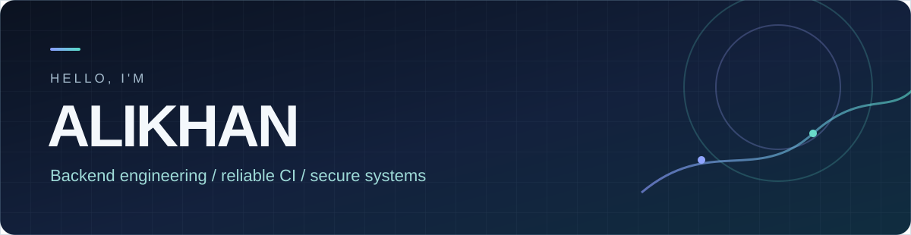

  

  
<strong>Backend & full-stack developer · Astana, Kazakhstan</strong>

  

    <a href="https://t.me/waattoo">Telegram</a> ·
    <a href="mailto:kokenaliko@gmail.com">Email</a> ·
    <a href="#selected-work">Selected work</a> ·
    <a href="#по-русски">По-русски</a>
  

---

### About

I build backend services and developer tooling, with a growing focus on **reliable CI, reproducible builds and secure execution boundaries**. I enjoy turning a vague failure into a small, testable change with clear evidence of what did and did not run.

My work spans Python APIs, Go utilities, TypeScript interfaces and Rust systems code. At [SoupTeam/soup-wall](https://github.com/SoupTeam/soup-wall), I contribute to CI admission and build verification, Linux pilot preparation and provider diagnostics. I also keep exploring Java through small, tested projects.

### What I use

| Area | Tools and technologies |
| :--- | :--- |
| Languages | Python · Rust · Go · TypeScript / JavaScript · Java |
| Backend & data | FastAPI · PostgreSQL · SQLAlchemy · REST APIs |
| Frontend | React · Vite · Tailwind CSS |
| Delivery & systems | Linux · Docker · GitHub Actions · Git · automated tests |
| Applied ML | pandas · scikit-learn · XGBoost · SHAP |

These are tools I've used in projects, not a claim of equal depth in every technology.

### Selected work

| Project | What it shows |
| :--- | :--- |
| [Soup Wall ↗](https://github.com/SoupTeam/soup-wall) | Contributions to source-aware CI, verified build reuse, installed-pilot tooling and provider transport diagnostics in a security-focused codebase. |
| [Incident Predictor ↗](https://github.com/Zaywoo66/Incident-predictor) | Infrastructure incident prediction from system metrics, with XGBoost/SHAP, a FastAPI service and a React interface. |
| [Smart Test Trigger ↗](https://github.com/Zaywoo66/Smart-test-trigger) | A GitHub Action that uses Python AST dependency analysis to select affected tests, with conservative full-suite fallback. |
| [TAU-PARK ↗](https://github.com/Zaywoo66/tau-park-project) | A booking application with a React/TypeScript frontend and a FastAPI/PostgreSQL backend. |
| [Log Analyzer ↗](https://github.com/Zaywoo66/log-analyzer) | A Go CLI that streams nginx access logs and reports traffic, status codes and latency percentiles. |

### How I work

I care about **explicit scope**, **useful failure messages** and **tests that exercise the real boundary**. When a result depends on a particular source revision or environment, I try to make that dependency visible instead of calling a partial run “green.”

### По-русски

Привет, я Алихан. Разрабатываю серверные сервисы и инструменты для разработчиков. Сейчас особенно интересуюсь надёжным CI, воспроизводимой сборкой и безопасными границами выполнения. Работаю с Python, Go, TypeScript и Rust; изучаю Java на небольших проектах с тестами. В [Soup Wall](https://github.com/SoupTeam/soup-wall) участвую в задачах по проверке сборок, CI и подготовке Linux-окружения. Выше — проекты с исходным кодом, по которым можно посмотреть мой подход к работе.

  Have a project or an interesting engineering problem? <a href="https://t.me/waattoo">Let's talk.</a>

